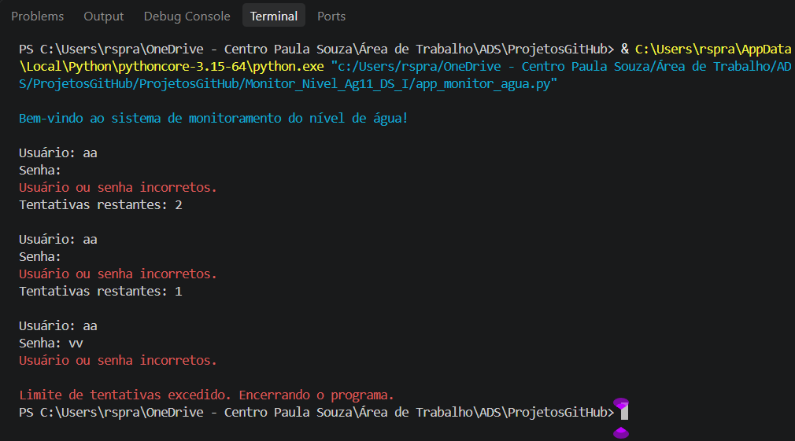
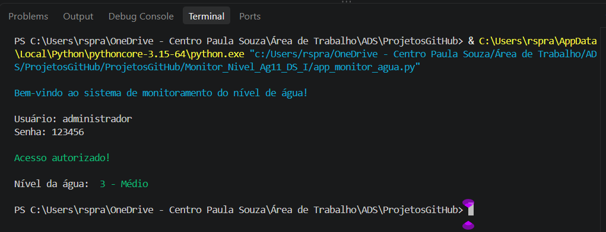

<div align="center">

# Monitoramento de Água

Aplicação para monitoramento de água, desenvolvida em Python, da tarefa da agenda 11 da matéria de Desenvolvimento de Sistemas I.

[](https://www.python.org/)
[](https://www.markdownguide.org/)

</div>

## Sobre o projeto

O projeto tem como ponto de entrada o arquivo `app_monitor_agua.py` e é voltado ao monitoramento do nível de água seja em reservatório ou em um curso perene.
Nesse projeto foi desenvolvido as habilidades de desenvolvimento de soluções de autenticação, simples, com usuário e senha, alteração das cores das fontes e seus controles, importação de bibliotecas, listas, loops e a elaboração e definições de funções.

## Como executar

É necessário ter o [Python](https://www.python.org/downloads/) instalado. No terminal, dentro da pasta do projeto, execute:

```bash
python app_monitor_agua.py
```

## Tecnologias 

- **Python** — linguagem utilizada na aplicação.
- **Markdown** — formato deste README.

## Telas do programa




